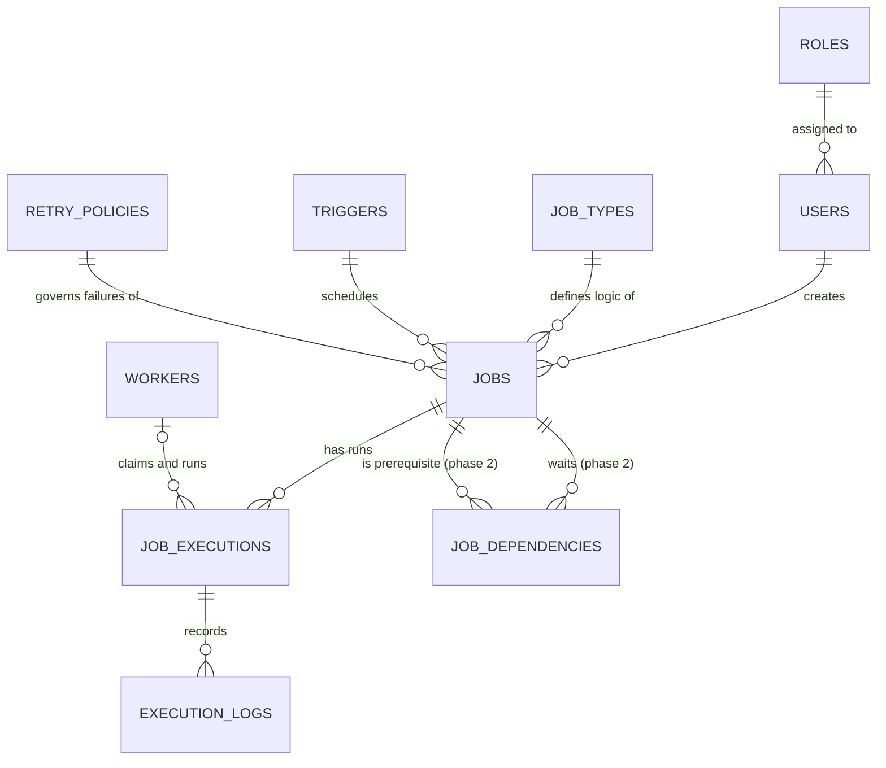

git pull # Database Design — DBOS

This document describes the Oracle schema behind DBOS: what each table is for, how the tables connect, and why the design is shaped this way. It is the reference for the ER diagram, the DDL, and the DBMS report.

---

## 1. The core idea: a job is described in layers

A job in DBOS is not one row with everything crammed in. It is described in four layers, each answering a different question, and each living in its own table(s):

| Layer | Question it answers | Where it lives |
|---|---|---|
| **Identity** | Which job is this? | `JOBS` |
| **Rules** | When does it run, and what happens on failure? | `TRIGGERS`, `RETRY_POLICIES` |
| **Logic** | What does it actually do? | `JOB_TYPES` |
| **Outcome** | What happened when it ran? | `JOB_EXECUTIONS`, `EXECUTION_LOGS` |

Around those sit the supporting tables: who owns and operates the system (`ROLES`, `USERS`), who executes work (`WORKERS`), and, planned for phase 2, which jobs wait on others (`JOB_DEPENDENCIES`).

**The guiding principle: the job is the rule, an execution is one run of it.** A job like "clean temp files every 10 seconds" exists once and lives forever. Every time it fires, that is a separate execution with its own status, timing, worker and logs. Status therefore belongs to the execution, never to the job.

---

## 2. Entity-relationship overview

---

## 3. Tables, layer by layer

Types are Oracle types. Oracle XE has no native boolean, so flags are `NUMBER(1)` with a `CHECK` of 0 or 1. Primary keys are identity columns.

### 3.1 Identity layer

**`JOBS`** is the recurring rule: the permanent identity of a job. It holds no status.

| Column | Type | Constraints |
|---|---|---|
| `job_id` | NUMBER | PK, identity |
| `name` | VARCHAR2(100) | NOT NULL |
| `job_type_id` | NUMBER | FK → `JOB_TYPES`, NOT NULL |
| `trigger_id` | NUMBER | FK → `TRIGGERS`, NOT NULL |
| `retry_policy_id` | NUMBER | FK → `RETRY_POLICIES`, NOT NULL |
| `created_by_user_id` | NUMBER | FK → `USERS`, NOT NULL |
| `is_active` | NUMBER(1) | NOT NULL, default 1, CHECK in (0, 1) |
| `created_at` | TIMESTAMP | NOT NULL |

The **id identifies** a job. The **name is descriptive**: it is what a human reads in the CLI or GUI, but nothing in the system relies on it to find or link a job. Every foreign key points at `job_id`.

`is_active` switches off the whole recurring rule (no new executions get created). That is different from cancelling a single pending run, which is a status on an execution.

### 3.2 Rules layer

**`TRIGGERS`** answers "when should this job run?"

| Column | Type | Constraints |
|---|---|---|
| `trigger_id` | NUMBER | PK, identity |
| `trigger_type` | VARCHAR2(20) | NOT NULL, CHECK in (`FIXED_RATE`, `ONE_TIME`) |
| `interval_seconds` | NUMBER | NULL for one-time triggers, > 0 otherwise |
| `fire_at` | TIMESTAMP | NULL for fixed-rate triggers |

A table-level check ties the columns to the type: a `FIXED_RATE` row must have `interval_seconds` and no `fire_at`; a `ONE_TIME` row must have `fire_at` and no `interval_seconds`. One-time triggers store an **absolute time**, not a delay, because a delay would silently restart its countdown every time the row is reloaded.

**`RETRY_POLICIES`** answers "what happens when a run fails?"

| Column | Type | Constraints |
|---|---|---|
| `policy_id` | NUMBER | PK, identity |
| `retry_type` | VARCHAR2(20) | NOT NULL, CHECK in (`EXPONENTIAL`, `FIXED`) |
| `max_retries` | NUMBER | NOT NULL, CHECK >= 0 |
| `backoff_seconds` | NUMBER | NOT NULL, CHECK >= 0 |

A job that should never retry points at a seeded row with `max_retries = 0`, so `JOBS.retry_policy_id` is never NULL.

Both tables can be **shared**: ten jobs that all run "every 30 minutes" can point at one trigger row. They map one-to-one onto the Java interfaces `Trigger` and `RetryPolicy`, so loading a row means constructing the matching `FixedRateTrigger`, `OneTimeTrigger`, `ExponentialBackoffPolicy` or `FixedDelayPolicy`.

### 3.3 Logic layer

**`JOB_TYPES`** answers "what does this job actually do?"

| Column | Type | Constraints |
|---|---|---|
| `job_type_id` | NUMBER | PK, identity |
| `type_code` | VARCHAR2(50) | NOT NULL, UNIQUE (e.g. `LOG_CLEANUP`) |
| `class_name` | VARCHAR2(255) | NOT NULL (the Java class that implements `Job`) |
| `description` | VARCHAR2(500) | |

This is the registry that connects a database row to executable code. The scheduler itself never knows what a job does; it only knows the `class_name` to load and call `execute()` on.

### 3.4 Outcome layer

**`JOB_EXECUTIONS`** has one row per run of a job. This is where status lives.

| Column | Type | Constraints |
|---|---|---|
| `execution_id` | NUMBER | PK, identity |
| `job_id` | NUMBER | FK → `JOBS`, NOT NULL |
| `worker_id` | NUMBER | FK → `WORKERS`, NULL until a worker claims it |
| `status` | VARCHAR2(20) | NOT NULL, CHECK in (`PENDING`, `RUNNING`, `DONE`, `FAILED`, `CANCELLED`) |
| `attempt_number` | NUMBER | NOT NULL, default 1, CHECK >= 1 |
| `scheduled_for` | TIMESTAMP | NOT NULL |
| `started_at` | TIMESTAMP | NULL until it starts |
| `ended_at` | TIMESTAMP | NULL until it ends, CHECK >= `started_at` |

The status values match the Java `JobStatus` enum exactly. The legal transitions are the same ones the enum enforces: PENDING to RUNNING or CANCELLED, RUNNING to DONE or FAILED, and DONE and CANCELLED are final. A retry is not a status moving backwards; it is a **new execution row** with `attempt_number` increased. An index on `(status, scheduled_for)` supports the "find the next due pending run" query.

**`EXECUTION_LOGS`** is the line-by-line history of one execution.

| Column | Type | Constraints |
|---|---|---|
| `log_id` | NUMBER | PK, identity |
| `execution_id` | NUMBER | FK → `JOB_EXECUTIONS`, NOT NULL |
| `log_level` | VARCHAR2(10) | NOT NULL, CHECK in (`INFO`, `WARN`, `ERROR`) |
| `message` | VARCHAR2(4000) | NOT NULL |
| `logged_at` | TIMESTAMP | NOT NULL |

A database trigger on `JOB_EXECUTIONS` writes a row here automatically on every status change, so the audit trail does not depend on application code remembering to log.

### 3.5 Access and actors

**`ROLES`**: `role_id` (PK), `role_name` (UNIQUE, CHECK in `ADMIN`, `OPERATOR`, `VIEWER`).

**`USERS`**: `user_id` (PK), `username` (UNIQUE, NOT NULL), `password_hash` (NOT NULL, never the plain password), `role_id` (FK → `ROLES`, NOT NULL), `created_at`.

Roles are enforced twice: the application hides actions a role cannot do, and database privileges deny them even if someone bypasses the application.

**`WORKERS`** is explained in the next section.

---

## 4. Workers: what they are and why the table exists

A **worker** is an independent unit of execution: something that picks up a pending execution and runs it. In the Java engine, workers are the tasks in the virtual-thread pool. In the database, a `WORKERS` row is that worker's identity.

| Column | Type | Constraints |
|---|---|---|
| `worker_id` | NUMBER | PK, identity |
| `worker_name` | VARCHAR2(100) | NOT NULL |
| `hostname` | VARCHAR2(100) | NOT NULL |
| `status` | VARCHAR2(10) | NOT NULL, CHECK in (`ACTIVE`, `DEAD`) |
| `started_at` | TIMESTAMP | NOT NULL |
| `last_heartbeat` | TIMESTAMP | NOT NULL |

**Workers are what run concurrently; safe claiming is what makes that concurrency correct.** Those are two separate things, and the design needs both:

- *Workers* are the concurrent actors. With four workers, four executions can be running at the same instant.
- *The claim step* is the coordination. The `claim_next_job` procedure selects the next due execution with `SELECT ... FOR UPDATE SKIP LOCKED`. A row one worker has locked is skipped by the others, so two workers can never grab the same execution and run a job twice.

The table earns its place in two ways:

1. **Attribution.** `JOB_EXECUTIONS.worker_id` records who ran each execution. The logs then show different workers running different jobs at the same time, which is visible evidence of concurrency in the demo.
2. **Crash recovery.** Each worker updates `last_heartbeat` regularly. If the process is killed, its worker rows stop updating. On restart, the reconciler finds workers whose heartbeat is stale, marks them `DEAD`, marks the `RUNNING` executions they owned as `FAILED`, and lets the retry policy decide whether to re-queue them. Without this, an execution claimed by a dead worker would stay `RUNNING` forever with nothing able to tell it was orphaned.

---

## 5. How one job moves through the schema

Take "clean temp files, every 10 seconds, retry up to 3 times with a fixed 2-second delay."

1. **Registering it.** A `TRIGGERS` row (`FIXED_RATE`, 10 seconds) and a `RETRY_POLICIES` row (`FIXED`, 3, 2) are created or reused. A `JOBS` row is created pointing at them, plus an existing `JOB_TYPES` row for the cleanup code.
2. **First run.** The engine creates a `JOB_EXECUTIONS` row: `PENDING`, attempt 1, `scheduled_for` 12:00:00.
3. **Claiming.** A worker's claim moves it to `RUNNING`, sets `worker_id` and `started_at`. The audit trigger writes a log row for the change.
4. **Success.** It becomes `DONE` with `ended_at` set, and another log row is written. The engine asks the trigger for the next fire time and creates a **new** `PENDING` execution for 12:00:10. The first execution stays `DONE` permanently as history.
5. **Failure.** It becomes `FAILED`, with an `ERROR` log row. If the retry policy allows another attempt, a new execution is created with `attempt_number` 2, scheduled two seconds out. If not, the run stays `FAILED`.

Nothing is ever overwritten, which is why one table of executions can answer questions like success rate per job or which jobs fail most.

---

## 6. Relationships and cardinality

| Relationship | Cardinality | Notes |
|---|---|---|
| `ROLES` → `USERS` | 1 to many | each user has exactly one role |
| `USERS` → `JOBS` | 1 to many | the creator |
| `JOB_TYPES` → `JOBS` | 1 to many | many jobs can share a type |
| `TRIGGERS` → `JOBS` | 1 to many | trigger rows can be shared |
| `RETRY_POLICIES` → `JOBS` | 1 to many | policy rows can be shared |
| `JOBS` → `JOB_EXECUTIONS` | 1 to many | one rule, many runs |
| `WORKERS` → `JOB_EXECUTIONS` | 1 to many (optional) | an unclaimed execution has no worker |
| `JOB_EXECUTIONS` → `EXECUTION_LOGS` | 1 to many | |
| `JOBS` ↔ `JOBS` via `JOB_DEPENDENCIES` | many to many, self-referencing | phase 2 |

---

## 7. Normalization notes (for the report)

All tables are in 3NF: every non-key column depends on the key, the whole key, and nothing but the key.

- `JOBS` holds only facts about the job itself. Trigger, retry and type details are held by reference, so changing a shared trigger changes it in one place.
- `TRIGGERS` and `RETRY_POLICIES` as separate tables are chosen mainly for reuse and to avoid a `JOBS` table full of columns that are NULL for most rows (a future cron trigger would add one more). The `CHECK` constraints keep the type-specific columns consistent.
- Status exists only on `JOB_EXECUTIONS`. Keeping a copy on `JOBS` as well would store the same fact twice and let the two drift apart (an update anomaly).
- `JOB_EXECUTIONS` and `EXECUTION_LOGS` are split because one execution has many log lines; merging them would repeat the execution's data on every log row.
- `USERS` and `ROLES` are split so the role name is stored once, not once per user.
- `JOB_DEPENDENCIES` is the standard way to resolve a many-to-many relationship: a table whose composite key is the pair of foreign keys.

---

## 8. Phase 2: job dependencies

`JOB_DEPENDENCIES` (`job_id`, `depends_on_job_id`, composite PK, both FK → `JOBS`, CHECK that the two differ) lets one job wait for another.

**Recommendation: treat dependency enforcement as phase 2.** The reasons:

- It is the feature that complicates everything else. The claim procedure would need to check not just "is this execution due?" but "have its prerequisites finished?".
- Its meaning is not obvious for recurring jobs. If B depends on A and A runs every 10 seconds, does B wait for A's *latest* run to be `DONE`, or for every run? That needs a decision before it can be built correctly.
- The CHECK only stops a job depending on itself. A cycle (A needs B, B needs A) needs a trigger or an application check to reject.
- Neither course rubric requires it. The ER, DDL, joins, PL/SQL, privileges and transactions are all covered without it.

**What to do now:** keep the table in the ER diagram, so the design does not have to be redone, and the self-referencing many-to-many is a good thing to show in the report. Implement the enforcement (claim-time check, cycle prevention) only after the core engine milestone. If time runs short it is the first thing cut, and in that case remove it from the final diagram so the report matches what was built.

---

## 9. Open decisions

1. **Is `JOBS.name` unique?** If names can repeat, there is no natural meaning for the "job already exists" case in `JobStore.addJob`. Either make `name` UNIQUE, or drop the duplicate-check idea.
2. **Cascade on logs.** `ON DELETE CASCADE` from executions to logs conflicts with "history is never erased" if the archive procedure deletes old executions. Either the archive copies logs out first, or the cascade is dropped.
3. **Worker granularity.** One `WORKERS` row per logical worker in the pool (for example four of them, which makes the demo show concurrency clearly), or one row per application instance. The first is the suggested default.
4. **`WORKERS.status` is derivable** from how stale `last_heartbeat` is. Keeping both is convenient for queries but can disagree; either the reconciler is the only thing that writes `status`, or the column is dropped.
5. **Seeded "no retry" policy row** and the **`OneTimeTrigger` constructor taking an `Instant`** (needed to rebuild from `fire_at`) both need agreeing on before DDL and `OracleJobStore` are written.
